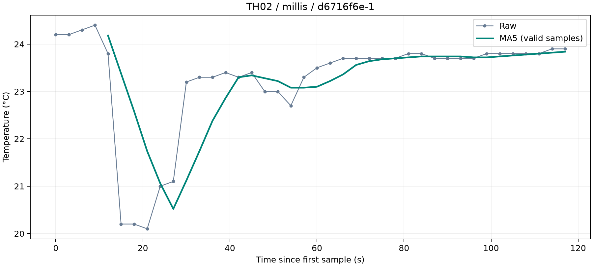
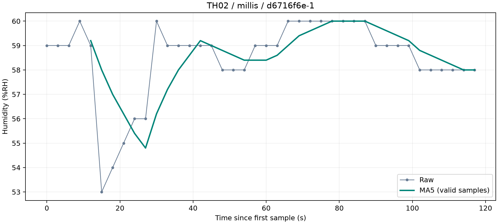
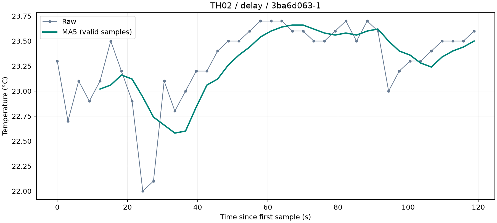
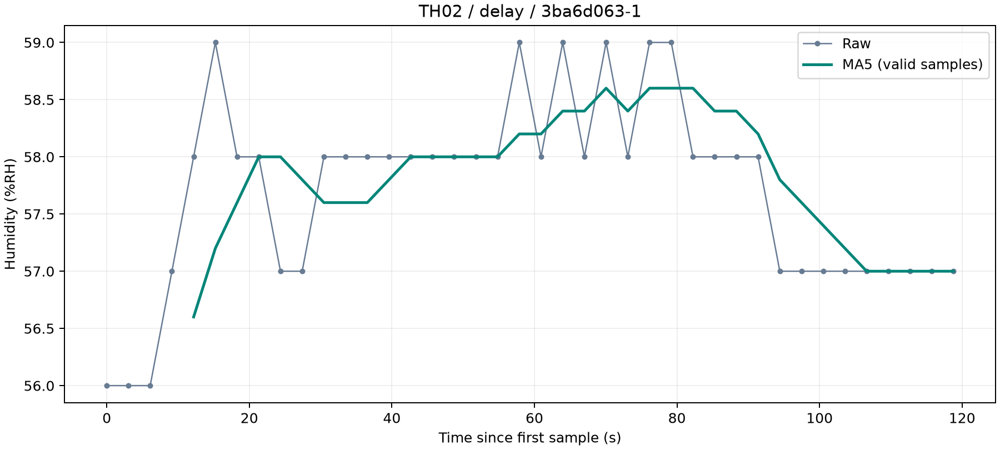

# Bài 2 – Đọc và kiểm tra cảm biến

Họ tên: **Đào Phương Linh** · MSSV: **23110186** · Nhóm: **Bài cá nhân theo thông báo của giảng viên**

## File trong repo này

Project dùng **PlatformIO, Arduino framework**. Hai bản dùng `delay()` và `millis()` trong mẫu được tổ chức bằng các file `.cpp` dưới đây; phần tác vụ chung nằm trong `src/main.cpp`.

- [src/schedule_delay.cpp](src/schedule_delay.cpp) – bản dùng `delay()`, environment `blocking`.
- [src/schedule_millis.cpp](src/schedule_millis.cpp) – bản dùng `millis()`, environment `esp32doit-devkit-v1`.
- [src/main.cpp](src/main.cpp) – đọc DHT11, ADC, xử lý nút/LCD, ghi CSV và gọi bộ lọc.
- [include/th2_core.h](include/th2_core.h) – MA5 và chống dội nút; [include/th2_config.h](include/th2_config.h) – bảng cấu hình; [include/sampling_schedule.h](include/sampling_schedule.h) – giao diện lập lịch.
- [platformio.ini](platformio.ini) – cấu hình board, framework, thư viện và hai environment.
- `data/` – 3 lượt đo chính, mỗi lượt có CSV mẫu, CSV sự kiện và log Serial gốc (9 tệp). CSV mẫu có `t_ms` (timestamp ms), `adc_raw` (số ADC), `adc_percent` (% toàn thang), `adc_mv` (mV), `temp_c` (°C), `rh_pct` (%RH), `valid` và `error`; hai cột MA5 là `temp_ma5`, `rh_ma5`.
- `figures/` – 4 ảnh PNG so sánh gốc/MA5 và 3 JSON thống kê; liên kết hình ở mục 4.3.
- [scripts/capture_serial.py](scripts/capture_serial.py), [scripts/analyze_csv.py](scripts/analyze_csv.py), [scripts/requirements.txt](scripts/requirements.txt) – công cụ ghi và phân tích dữ liệu.
- [CONTRIBUTIONS.md](CONTRIBUTIONS.md) – đóng góp cá nhân và phần được hỗ trợ.

| Lượt chính | Số mẫu | Ba tệp minh chứng gốc |
|---|---|---|
| millis, d6716f6e-1 | 40 hợp lệ | [CSV mẫu](data/TH02-millis-d6716f6e-1-20261027-132835-455331-samples.csv), [CSV sự kiện](data/TH02-millis-d6716f6e-1-20261027-132835-455331-events.csv), [log](data/TH02-20261027-132835-455331-serial.log) |
| delay, 3ba6d063-1 | 40 hợp lệ | [CSV mẫu](data/TH02-delay-3ba6d063-1-20261027-133849-438750-samples.csv), [CSV sự kiện](data/TH02-delay-3ba6d063-1-20261027-133849-438750-events.csv), [log](data/TH02-20261027-133849-438750-serial.log) |
| Thử lỗi/phục hồi, 5aae8f44-1 | 22 hợp lệ, 8 lỗi | [CSV mẫu](data/TH02-delay-5aae8f44-1-20261027-140229-928148-samples.csv), [CSV sự kiện](data/TH02-delay-5aae8f44-1-20261027-140229-928148-events.csv), [log](data/TH02-20261027-140229-928148-serial.log) |

## 4.1 Cấu hình (setup)

Em chọn **A – đo ngắn**, thực hiện tại nhà ngày **27/10/2026** bằng **ESP32 DevKit V1 và DHT11 module 3 chân**. Chu kỳ lấy mẫu đặt **3000 ms**; giao tiếp Serial **115200 baud**, cổng thực tế khi đo là **COM3**. Hai lượt so sánh có 40 mẫu mỗi lượt; lượt thử lỗi/phục hồi bổ sung có 30 mẫu.

### Bảng chân và đối chiếu sơ đồ

| Thành phần | Kết nối ESP32 | Ghi chú |
|---|---|---|
| DHT11 DATA/S | GPIO14 | Cấu hình loại DHT11 |
| DHT11 VCC/GND | 3V3 và GND | Module thực tế 3 chân |
| Biến trở, chân giữa | GPIO34 | ADC1, 12 bit |
| Biến trở, hai chân ngoài | 3V3 và GND | Nguồn thực tế |
| Nút nhấn ngoài | GPIO27 và GND | INPUT_PULLUP, nhấn LOW; chống dội 35 ms |
| LCD SDA/SCL | GPIO21 và GPIO22 | I²C 100 kHz, địa chỉ thực tế 0x27 |
| LCD VCC/GND | 5V/VIN và GND chung | |

LCD thực tế 16×2 đã hiển thị số đo. Nếu backpack kéo SDA/SCL lên 5 V, cần bộ chuyển mức I²C hai chiều 3,3/5 V; chưa có thông tin xác nhận bộ chuyển mức trong mạch thực tế.

Đối chiếu sơ đồ nhà kính: **DHT11 - J1 - DATA_RH - GPIO14**. Bộ đo riêng cũng dùng DATA ở GPIO14, với module DHT11 và nguồn 3V3 của ESP32.

### Đọc và quy đổi ADC

- Thiết bị và chân: biến trở, chân giữa nối GPIO34 (ADC1); hai chân ngoài nối 3V3 và GND.
- Độ phân giải, cấu hình dải đo: `analogReadResolution(12)`, mã lý thuyết 0–4095; suy hao `ADC_11db`. Các giá trị dưới đây lấy trực tiếp từ lượt `delay`, phiên `3ba6d063-1`.
- Đại lượng quy đổi và công thức: phần trăm toàn thang ADC, `adc_percent = adc_raw * 100 / 4095`. Đây là phần trăm mã ADC, không phải phần trăm góc xoay chính xác hay độ ẩm. Cột `adc_mv` được đọc riêng bằng `analogReadMilliVolts()`.

| Vị trí biến trở/tình huống | ADC gốc | Giá trị quy đổi và đơn vị | Nhận xét |
|---|---|---|---|
| Mẫu 23, giá trị thấp trong lượt xoay | 563 | 13,75%; đọc điện áp riêng 612 mV | Giá trị nhỏ nhất trong lượt này |
| Mẫu 28, một vị trí trung gian | 1857 | 45,35%; đọc điện áp riêng 1684 mV | Giá trị thay đổi theo thao tác xoay |
| Mẫu 32, giá trị cao trong lượt xoay | 3413 | 83,35%; đọc điện áp riêng 2849 mV | Giá trị lớn nhất trong lượt này |

**Giới hạn dải đo/bão hòa quan sát được:** lượt này ghi nhận 563–3413, tương ứng 13,75–83,35% toàn thang. Chưa chạm mã 0 hoặc 4095 nên chưa xác nhận điểm bão hòa hay dải điện áp chính xác tại hai đầu. Nguồn cấp biến trở 3,3 V không đồng nghĩa toàn dải điện áp đều tuyến tính với mã ADC. `adc_mv` là phép chuyển đổi riêng, không phải điện áp đo bằng đồng hồ của đúng lần đọc `adc_raw`. Minh chứng: [CSV ADC](data/TH02-delay-3ba6d063-1-20261027-133849-438750-samples.csv).

### Thiết bị I²C và log thực tế

| Mục | Kết quả thực tế |
|---|---|
| Thiết bị, kích thước LCD và nguồn | LCD I²C 16×2, VCC nối 5V/VIN theo xác nhận của người thực hiện, GND chung |
| SDA/SCL | GPIO21 / GPIO22; `Wire` chạy 100 kHz theo cấu hình mã nguồn |
| Địa chỉ tìm thấy | `0x27`, nhận ACK; lượt `millis` quét trong 19 ms |
| Nội dung hiển thị và kết quả giao tiếp | LCD khởi tạo thành công và hiển thị nhiệt độ, độ ẩm, ADC, số thứ tự mẫu. Nút ngoài đổi trang số đo gốc và MA5; ảnh bộ đo đã được quan sát trong quá trình thử |
| Tệp log/minh chứng | [Log lượt millis](data/TH02-20261027-132835-455331-serial.log), [CSV sự kiện](data/TH02-millis-d6716f6e-1-20261027-132835-455331-events.csv); dòng `#I2C,0x27,ACK`, sự kiện `lcd` ghi `initialized address=39 geometry=16x2` (39 thập phân = `0x27`) |

Quét được địa chỉ và sử dụng thiết bị là hai kết quả cần ghi. DHT11 là phần đọc cảm biến riêng, không dùng làm minh chứng ADC hoặc I²C.

Các dòng dưới đây được trích nguyên từ [log lượt millis](data/TH02-20261027-132835-455331-serial.log):

```text
#I2C,0x27,ACK
#EVENT,d6716f6e,d6716f6e-1,millis,2,70,"i2c_scan","SDA=21 SCL=22 addresses=0x27 scan_ms=19"
#EVENT,d6716f6e,d6716f6e-1,millis,3,197,"lcd","initialized address=39 geometry=16x2"
```

### Chạy project PlatformIO

Mở thư mục TH2 bằng PlatformIO/VS Code, dùng Arduino framework. Hai bản có chung tác vụ đọc cảm biến, ADC, lọc, nút và LCD; chỉ thay cách lập lịch:

| Environment | Cách lập lịch | Mã nguồn |
|---|---|---|
| esp32doit-devkit-v1 | Theo mốc millis() | [schedule_millis.cpp](src/schedule_millis.cpp) |
| blocking | Chờ dài delay() | [schedule_delay.cpp](src/schedule_delay.cpp) |

[platformio.ini](platformio.ini) chọn tệp qua build_src_filter. [main.cpp](src/main.cpp) chứa tác vụ chung; [th2_config.h](include/th2_config.h) khai báo chân, chu kỳ và giới hạn 300 mẫu mỗi lần khởi động. Dự án PlatformIO không cần thêm tệp .ino.

Lệnh chạy trong thư mục TH2; thay COMx bằng cổng USB thực tế (các lượt đã đo dùng COM3):

```powershell
pio run -e esp32doit-devkit-v1 -e blocking
python -m pip install -r scripts/requirements.txt
pio device list
pio run -e esp32doit-devkit-v1 -t upload --upload-port COMx
python scripts/capture_serial.py --port COMx --out-dir data --samples 40
```

Đóng Serial Monitor trước khi chạy logger. Khi thấy Connected, nhấn EN/RESET một lần để thu đầu phiên; giữ nguyên phiên trong suốt lượt thử. Nút ngoài đổi trang LCD giữa số đo gốc và MA5/ADC. Khi so sánh, thực hiện cùng tác vụ và ghi số lần nhấn vật lý.

Sau khi thu bản millis, nạp và ghi riêng bản delay:

```powershell
pio run -e blocking -t upload --upload-port COMx
python scripts/capture_serial.py --port COMx --out-dir data --samples 40
```

40 là số mẫu đã chọn; phương án A yêu cầu ít nhất 30 mẫu. Logger lưu từng phiên thành CSV mẫu, CSV sự kiện và log gốc, không ghi đè hoặc gộp phiên. Firmware không lưu lịch sử để tải lại sau khi logger dừng.

Phân tích một CSV đã đo và xuất hình:

```powershell
python scripts/analyze_csv.py data/TEN_TEP-samples.csv --out-dir figures
```

Thêm --summary-only nếu chỉ cần JSON. Hai bản là lập lịch phần mềm; đọc DHT11 và cập nhật LCD vẫn có thời gian thực thi, chưa phải timer interrupt.

## 4.2 Cách báo lỗi

Khi DHT11 không đọc được, chương trình vẫn ghi dòng CSV với timestamp và số thứ tự mẫu, đặt `valid=0`, `error=dht_read_failed`. Nhiệt độ, độ ẩm và hai cột MA5 để trống; không thay số đo thiếu bằng 0. ADC vẫn được đọc độc lập. LCD hiển thị `DHT11 READ ERROR`, Serial ghi thêm sự kiện `sensor_error`.

Một dòng lỗi thật, mẫu số 11 trong [CSV thử lỗi](data/TH02-delay-5aae8f44-1-20261027-140229-928148-samples.csv):

```csv
5aae8f44,5aae8f44-1,delay,11,33675,3046,,,0,dht_read_failed,3408,83.22,2846,,,60
```

Dòng log sự kiện tương ứng, trích từ [Serial log lượt thử lỗi](data/TH02-20261027-140229-928148-serial.log):

```text
#EVENT,5aae8f44,5aae8f44-1,delay,4,33735,"sensor_error","seq=11 dht_read_failed"
```

Mẫu CSV có `t_ms=33675`, `valid=0`, lý do `dht_read_failed`; ADC vẫn là 3408. Các ô nhiệt độ/độ ẩm/MA5 trống là giá trị thiếu, khác với một phép đo hợp lệ bằng 0.

| Mục | Kết quả thực tế | Minh chứng |
|---|---|---|
| Thời gian/lượt đo | Lượt thử lỗi ngày 27/10/2026, phiên `5aae8f44-1`, chế độ `delay`; mẫu đầu có `t_ms=3215`, mẫu cuối `t_ms=91901`, cách nhau 88,686 giây | [CSV thử lỗi](data/TH02-delay-5aae8f44-1-20261027-140229-928148-samples.csv) |
| Tổng số mẫu (A ít nhất 30 mẫu) | Lượt đo ngắn: 40 mẫu riêng cho mỗi bản `millis` và `delay` ở mục 4.4. Lượt thử lỗi/phục hồi bổ sung: 30 mẫu liên tục, số thứ tự 1–30 | Các CSV ở mục 4.4 và CSV thử lỗi |
| Số mẫu hợp lệ/lỗi | Hai lượt đo ngắn: mỗi lượt 40 hợp lệ, 0 lỗi. Lượt thử lỗi: 22 hợp lệ, 8 lỗi | CSV gốc và [thống kê lượt thử lỗi](figures/TH02-delay-5aae8f44-1-20261027-140229-928148-samples-summary.json) |
| Tình huống gây lỗi và nguyên nhân biết được | Thử ngắt dây DATA/S giữa DHT11 và GPIO14 theo quy trình. Mẫu 1–10 bình thường; mẫu 11–18 báo `dht_read_failed`, tương ứng đúng 8 sự kiện `sensor_error` | [CSV sự kiện thử lỗi](data/TH02-delay-5aae8f44-1-20261027-140229-928148-events.csv) và [log Serial gốc](data/TH02-20261027-140229-928148-serial.log) |
| Dữ liệu được ghi khi lỗi | Giữ dòng và timestamp; `valid=0`, `error=dht_read_failed`; `temp_c`, `rh_pct`, `temp_ma5`, `rh_ma5` để trống. ADC vẫn có dữ liệu ở cả 8 dòng lỗi | Mẫu 11–18 trong CSV thử lỗi |
| Kết quả sau khi khôi phục kết nối | Mẫu 19–30 đọc lại thành công, `valid=1`, có nhiệt độ, độ ẩm và MA5. Không reset giữa giai đoạn lỗi và phục hồi; kiểm tra MA5 không có sai lệch vượt ngưỡng 0,025 | Mẫu 19–30 trong CSV thử lỗi và tệp thống kê |

Giữ nguyên dòng lỗi và timestamp. Giá trị thiếu để trống/null, không thay bằng 0. Nếu có khoảng ngừng hoặc mất mẫu, ghi đúng hiện tượng.

Log Serial gốc còn chứa phiên khởi động `8deda0d3-1` gồm 6 mẫu trước khi reset và bắt đầu lượt chính. Log được giữ nguyên; ba lượt chính được lưu riêng thành các CSV liệt kê trong mục File trong repo này, không gộp dữ liệu giữa các phiên.

## 4.3 Bộ lọc đã chọn

Em chọn **trung bình trượt 5 mẫu hợp lệ (MA5)**. Sau mỗi mẫu hợp lệ, thêm số đo mới vào cửa sổ và bỏ số đo hợp lệ cũ nhất nếu cửa sổ đã đủ 5 mẫu. Công thức là tổng 5 giá trị trong cửa sổ chia 5. Bộ lọc chạy trên ESP32 trong [MovingAverage5](include/th2_core.h); kết quả được ghi vào CSV gốc ở hai cột riêng.

- Bộ lọc: trung bình trượt 5 mẫu hợp lệ.
- Mẫu lỗi được giữ trong dữ liệu gốc và không đưa vào cửa sổ lọc.
- Cả hai lượt đều có 40 mẫu hợp lệ: bốn mẫu đầu để trống MA5, có 36 giá trị lọc từ mẫu 5 đến mẫu 40.

Mỗi ảnh vẽ dữ liệu gốc (`Raw`, xám) và MA5 (xanh) trên cùng trục thời gian, tính từ `t_ms` và quy về 0 tại mẫu đầu tiên của lượt đó. Hai lượt được đo riêng, không phải cùng một thời điểm.

| Lượt đo | Nhiệt độ gốc/MA5 | Độ ẩm gốc/MA5 | Thống kê và kiểm tra MA5 |
|---|---|---|---|
| `millis()` | [Biểu đồ nhiệt độ](figures/TH02-millis-d6716f6e-1-20261027-132835-455331-samples-temperature.png) | [Biểu đồ độ ẩm](figures/TH02-millis-d6716f6e-1-20261027-132835-455331-samples-humidity.png) | [JSON thống kê](figures/TH02-millis-d6716f6e-1-20261027-132835-455331-samples-summary.json) |
| `delay()` | [Biểu đồ nhiệt độ](figures/TH02-delay-3ba6d063-1-20261027-133849-438750-samples-temperature.png) | [Biểu đồ độ ẩm](figures/TH02-delay-3ba6d063-1-20261027-133849-438750-samples-humidity.png) | [JSON thống kê](figures/TH02-delay-3ba6d063-1-20261027-133849-438750-samples-summary.json) |

**Lượt `millis()`**





**Lượt `delay()`**





**Độ mượt:** MA5 làm giảm các bước nhảy giữa hai mẫu liên tiếp. Để so sánh công bằng, tính trung bình độ biến thiên tuyệt đối `mean(|x[k] - x[k-1]|)` cho cả dữ liệu gốc và MA5 trên cùng đoạn mẫu 5–40, tức 35 khoảng giữa các mẫu:

| Lượt | Đại lượng và đơn vị | Dữ liệu gốc | MA5 | Mức giảm |
|---|---|---:|---:|---:|
| `millis()` | Nhiệt độ (°C/mẫu) | 0,2657 | 0,2154 | 18,9% |
| `millis()` | Độ ẩm (điểm %RH/mẫu) | 0,5429 | 0,3771 | 30,5% |
| `delay()` | Nhiệt độ (°C/mẫu) | 0,1800 | 0,0754 | 58,1% |
| `delay()` | Độ ẩm (điểm %RH/mẫu) | 0,3714 | 0,1371 | 63,1% |

Hai bản dùng cùng công thức MA5; mức giảm khác nhau phụ thuộc dữ liệu đầu vào của từng lượt. Chỉ số này mô tả độ mượt, chưa chứng minh cảm biến đo chính xác hơn hoặc mọi biến động đều là nhiễu.

**Độ trễ và hạn chế:** Trong lượt `millis()`, nhiệt độ gốc thấp nhất 20,10 °C ở mẫu 8, còn MA5 thấp nhất 20,52 °C ở mẫu 10: đáy đường lọc xuất hiện muộn hơn 2 mẫu, tương ứng 6 giây, và biên độ giảm nhỏ hơn. MA5 dùng mẫu hiện tại và bốn mẫu trước nên phản ứng chậm khi giá trị thay đổi nhanh. Với mẫu đều, tuổi trung bình của cửa sổ là 2 chu kỳ: 6 giây ở lượt `millis()` và 6,092 giây ở lượt `delay()`. Đây là tính chất của cửa sổ lọc, không phải phép đo độc lập thời gian phản hồi cảm biến. Hai lượt vẽ biểu đồ không có mẫu lỗi; minh chứng lỗi/phục hồi bổ sung nằm ở mục 4.2. Trong lượt thử lỗi, bộ lọc bỏ qua mẫu lỗi và giữ cửa sổ các mẫu hợp lệ trước đó, nên mẫu hợp lệ đầu tiên sau khi nối lại đã có MA5. Các giá trị trước khoảng lỗi vẫn tham gia cửa sổ; độ dài cửa sổ theo thời gian thực tăng khi lỗi kéo dài. Đối chiếu MA5 từ dữ liệu gốc bằng script: không có sai lệch vượt ngưỡng kiểm tra 0,025 ở cả hai lượt vẽ biểu đồ và lượt thử lỗi.

## 4.4 Kết quả thí nghiệm lập lịch

Em chạy hai bản với cùng chu kỳ đặt 3000 ms và cùng tác vụ nút đổi trang LCD. Mỗi bản ghi 40 mẫu có timestamp để so sánh khoảng cách lấy mẫu và khả năng nhận nút.

| Mục | Bản chờ dài (`delay`) | Bản mốc thời gian (`millis`) |
|---|---|---|
| Tệp CSV/mã boot-session | `data/TH02-delay-3ba6d063-1-20261027-133849-438750-samples.csv`; phiên `3ba6d063-1` | `data/TH02-millis-d6716f6e-1-20261027-132835-455331-samples.csv`; phiên `d6716f6e-1` |
| Số mẫu đã ghi | 40; tất cả hợp lệ, không thiếu số thứ tự mẫu | 40; tất cả hợp lệ, không thiếu số thứ tự mẫu |
| Chu kỳ đặt (ms) | 3000 | 3000 |
| Khoảng cách mẫu trung bình/nhỏ nhất/lớn nhất (ms) | 3046 / 3046 / 3046 | 3000 / 3000 / 3000 |
| Sai lệch chu kỳ quan sát được | +46 ms trong mỗi khoảng cách mẫu đã ghi | 0 ms trong 39 khoảng cách mẫu đã ghi |
| Số lần nhấn nút và số lần chương trình nhận | Người thực hiện xác nhận có nhấn nhưng không nhớ số lần; 0 sự kiện `button` trong CSV sự kiện cùng phiên | 6 lần nhấn thực tế (người thực hiện xác nhận), 6 sự kiện `button` trong CSV sự kiện cùng phiên |
| Khả năng phản hồi khi đang lấy mẫu | Không ghi nhận lần nhấn nào trong lượt thử này; không tính tỷ lệ nhận vì chưa biết số lần nhấn thực tế | Nhận đủ 6/6 lần nhấn và ghi đổi trang LCD; chưa đo độc lập độ trễ từ lúc nhấn vật lý |

**Nhận xét:** Trong hai lượt đã ghi, bản `millis()` duy trì khoảng cách mẫu 3000 ms và nhận đủ 6/6 lần nhấn; bản `delay()` có khoảng cách mẫu 3046 ms và không ghi nhận nút dù người thực hiện xác nhận đã nhấn. Kết quả phù hợp với mã dùng chờ dài: ngoài 3000 ms chờ còn có thời gian thực thi tác vụ, và vòng lặp không kiểm tra nút trong khi chờ. Không suy ra số lần bỏ lỡ cụ thể của bản `delay()` vì số lần nhấn vật lý không được đếm. Timestamp sự kiện chỉ là lúc chương trình nhận nút, chưa đo độc lập độ trễ từ lúc nhấn vật lý. Đây là kết quả của hai lượt thử này, chưa phải thí nghiệm timer phần cứng.

Một dòng lấy mẫu thật từ [CSV bản millis](data/TH02-millis-d6716f6e-1-20261027-132835-455331-samples.csv); `t_ms` là thời gian tính từ lúc ESP32 khởi động, đơn vị ms:

```csv
boot_id,session_id,mode,seq,t_ms,dt_ms,temp_c,rh_pct,valid,error,adc_raw,adc_percent,adc_mv,temp_ma5,rh_ma5,read_ms
d6716f6e,d6716f6e-1,millis,5,15197,3000,23.80,59.00,1,,2382,58.17,2120,24.18,59.20,26
```

Ở mẫu số 5, khoảng cách với mẫu trước là 3000 ms; nhiệt độ gốc 23,80 °C và MA5 24,18 °C. Dữ liệu gốc và lọc đều được giữ lại để đối chiếu.

## 4.5 Đóng góp cá nhân

Em trực tiếp thực hiện các công việc sau trên bộ đo tại nhà:

- Lắp DHT11, biến trở, nút ngoài và LCD theo bảng chân; sửa lại kết nối biến trở để đọc đúng khi xoay.
- Nạp hai phiên bản chương trình bằng PlatformIO và chạy công cụ ghi Serial để thu các CSV thực tế.
- Xoay biến trở, kiểm tra LCD, thử nút trong hai lượt đo; xác nhận 6 lần nhấn ở bản `millis()`.
- Thử ngắt/nối lại DATA DHT11 và thu được 10 mẫu bình thường, 8 mẫu lỗi, 12 mẫu phục hồi trong cùng phiên.

Codex hỗ trợ soạn mã firmware, công cụ ghi/phân tích CSV, tạo biểu đồ, kiểm tra dữ liệu và tổng hợp tài liệu. Phần thao tác phần cứng và thu dữ liệu do em trực tiếp thực hiện. Bảng công việc chi tiết nằm trong [CONTRIBUTIONS.md](CONTRIBUTIONS.md).

Kết quả em dùng để đối chiếu gồm: ADC quy đổi theo `raw * 100 / 4095`; DHT11 dùng chân dữ liệu riêng, LCD dùng I²C ở `0x27`; MA5 bỏ qua mẫu lỗi và làm mượt nhưng có độ trễ; bản `delay()` không kiểm tra nút trong lúc chờ dài. Em cần tự rà soát cách giải thích mã nguồn và các nhận xét trước khi nộp. Chưa đo độc lập độ trễ từ lúc nhấn nút vật lý, chưa có phép đo tham chiếu để đánh giá độ chính xác tuyệt đối của ADC và cảm biến.
