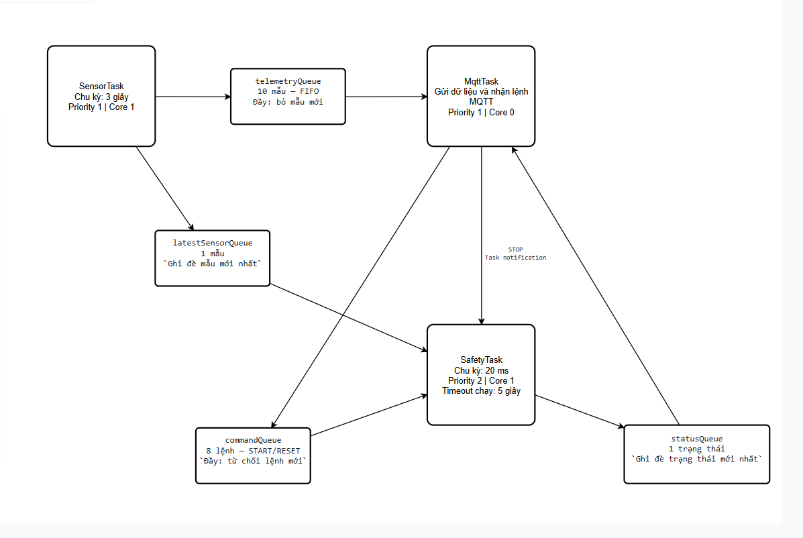

# Bài 4 — Gửi dữ liệu qua MQTT

Họ tên: Đào Phương Linh · MSSV: 23110186 · Nhóm: Không áp dụng (bài cá nhân)

## File trong repo này

- docker-compose.yml — cấu hình broker (đã bỏ bí mật)
- firmware/ — code FreeRTOS cho ESP32
- topic_payload.md — mô tả topic và cấu trúc payload
- log_10min.txt — log subscribe liên tục 10 phút
- log_disconnect.txt — log thử ngắt/nối lại broker

## 4.1 Payload thực tế

ESP32 đọc số đo thật từ DHT11 tại GPIO 14 và publish JSON đến topic `sv23110186/node01/telemetry`. Payload dưới đây lấy từ bản tin cuối trong `log_10min.txt`, được máy nhận ghi lúc `2026-11-08T20:14:35+0700`:

```json
{
  "device_id": "node01",
  "temp_unit": "C",
  "hum_unit": "%",
  "uptime_unit": "s",
  "temp": 29,
  "hum": 70,
  "temp_valid": true,
  "hum_valid": true,
  "rssi": -75,
  "seq": 208,
  "uptime": 624,
  "ledR": 0,
  "state": "STOPPED",
  "safety_checks": 31202
}
```

`device_id` định danh thiết bị; `temp` và `hum` lần lượt là nhiệt độ và độ ẩm tương đối, với đơn vị do `temp_unit` và `hum_unit` chỉ rõ. `temp_valid` và `hum_valid` cho biết kết quả tương ứng có phải số hữu hạn hay không. Khi đọc lỗi, trường số đo được gửi dưới dạng `null` và cờ hợp lệ là `false`; giá trị `0` được giữ nguyên khi kết quả đọc hợp lệ. `rssi` là cường độ tín hiệu Wi-Fi, đơn vị dBm. `seq` tăng ở mỗi lượt lấy mẫu, kể cả mẫu bị bỏ khi queue đầy. `uptime` là thời gian tại lúc lấy mẫu, tính bằng giây từ khi ESP32 khởi động, với đơn vị `uptime_unit="s"`; đây không phải Unix timestamp. `ledR` bằng `1` khi LED đỏ được bật trong trạng thái chạy và bằng `0` khi không chạy. `state` là trạng thái FSM (`STOPPED`, `RUNNING`, `FAULT`), còn `safety_checks` đếm số lượt kiểm tra của SafetyTask. Thời gian đầu dòng log do máy nhận thêm, nằm ngoài JSON. Các trường cảm biến thuộc mẫu trong queue; RSSI và trạng thái an toàn được lấy khi chuẩn bị publish nên có thể mới hơn mẫu đang chờ. Cấu trúc topic và giải thích chi tiết được lưu trong `topic_payload.md`.

Lượt thu `log_10min.txt` bắt đầu lúc `20:04:31` và kết thúc lúc `20:14:35` ngày 08/11/2026, dài **604 giây (10 phút 4 giây)**, nhận **203 bản tin JSON hợp lệ**. Dãy `seq=1–208` thiếu **5 mẫu `seq=7–11`**; khoảng nhận giữa `seq=6` và `seq=12` là `20:04:31–20:04:47`, dài 16 giây. Sau đó `seq=12–208` liên tiếp, không thiếu thêm số thứ tự; cả 203 bản tin đều có hai cờ chất lượng bằng `true`. Log này ghi nhận mất mẫu lúc đầu và không được mô tả là truyền không mất dữ liệu. Tôi thu log trên **cùng máy tính chạy broker**; hiện chưa có lượt thu trên một máy tính khác. Phần cứng trong phiên bản này mới sử dụng DHT11, **chưa bổ sung cảm biến mưa**.

## 4.2 Task và queue

Node `node01` chạy firmware FreeRTOS trên ESP32; broker Mosquitto chạy trên PC bằng Docker Compose, mở cổng MQTT TCP `1883` và yêu cầu tài khoản/mật khẩu. Máy PC này cũng đang chạy `mosquitto_sub` để quan sát và lưu log. Khi mới clone repo, chạy `.\scripts\setup_broker.ps1` trong PowerShell tại thư mục TH4 để nhập mật khẩu, tạo tài khoản broker và khởi động container; các lần sau có thể dùng `docker compose up -d`. Cách tạo cấu hình Wi-Fi/MQTT riêng và build/nạp firmware được ghi trong `firmware/README.md`. Thông tin mật khẩu thật nằm ngoài Git, repo cung cấp mẫu `firmware/include/secrets.example.h`.

Firmware tạo ba task: **SensorTask** đọc DHT11 mỗi `3000 ms`, priority 1, core 1; **MqttTask** quản lý Wi-Fi, publish dữ liệu và nhận lệnh, priority 1, core 0; **SafetyTask** kiểm tra nút nhấn và cập nhật FSM mỗi `20 ms`, priority 2, core 1. START dùng GPIO 27, STOP dùng GPIO 25; đầu ra đang kiểm thử là LED đỏ GPIO 26. Khi RUNNING đủ `5000 ms`, FSM tự dừng do timeout. Khi dữ liệu cảm biến không hợp lệ hoặc cũ quá `7000 ms`, SafetyTask đưa hệ về FAULT; phải reset khi đầu vào đã hợp lệ trở lại và nhận START mới để chạy.

Các task trao đổi qua bốn queue có giới hạn: **telemetryQueue** chứa 10 mẫu, SensorTask gửi cho MqttTask theo FIFO; đầy thì bỏ mẫu mới và tăng `dropped`, giữ các mẫu đang chờ. **latestSensorQueue** chứa 1 mẫu, SensorTask ghi đè mẫu mới nhất để SafetyTask đọc độc lập với telemetryQueue. **commandQueue** chứa 8 lệnh START/RESET từ callback của MqttTask sang SafetyTask; đầy thì từ chối lệnh mới. **statusQueue** chứa 1 trạng thái, SafetyTask ghi đè trạng thái mới để MqttTask đưa vào payload và `loop()` đọc để in heartbeat. Lệnh MQTT STOP được chuyển trực tiếp bằng task notification đến SafetyTask; khi xử lý STOP, task ưu tiên dừng và xóa các lệnh đang chờ. Sơ đồ quan hệ task/queue tôi vẽ trên Visual Paradigm được lưu dưới đây:



SensorTask gửi queue với thời gian chờ bằng 0; SafetyTask cũng đọc queue/notification với thời gian chờ bằng 0 và không gọi Wi-Fi/MQTT trong vòng kiểm tra. Việc kết nối lại hoặc chờ MQTT chỉ diễn ra trong MqttTask, vì vậy không tạo thời gian chờ mạng vô hạn cho vòng an toàn. MqttTask dùng `xQueuePeek()` và chỉ lấy mẫu khỏi telemetryQueue sau khi `client.publish()` trả về thành công; QoS 0 vẫn cần log phía nhận để xác nhận dữ liệu thực sự đến nơi. Bản firmware hiện đặt `queueStressTest = false`; khi thử tải đã đặt `true` để bên gửi chỉ thử gửi một mẫu mỗi `8000 ms`, chậm hơn chu kỳ lấy mẫu 3 giây.

Trong **phiên khởi động cuối** của `log_queue_full.txt`, bắt đầu khoảng `17:52:30` ngày 08/11/2026, log ghi `QUEUE_STRESS=1`. Đến `17:53:03.114`, queue đạt 10 mẫu; dòng cuối của SensorTask lúc `17:54:36.114` ghi `seq=42 queue=10 dropped=21`. SafetyTask vẫn phản hồi START lúc `17:53:36.089`, STOP lúc `17:53:40.089`, START lúc `17:53:46.089` và tự dừng do timeout lúc `17:53:51.089`; cuối phiên có `checks=6351 max_gap_ms=20 late=0`. File gốc cũng chứa các phiên khởi động trước có `max_gap_ms=21 late=1` và các lỗi MQTT; các chỉ số 20 ms/late=0 ở đây chỉ mô tả phiên cuối, không phải toàn bộ file hay một lượt mạng hoàn toàn ổn định.

## 4.3 Thí nghiệm ngắt kết nối

Tôi thử dừng rồi khởi động lại broker bằng Docker Compose và lưu hai mốc thao tác trong `broker_actions.txt`: `STOPPED 2026-11-08T16:51:58.2005209+07:00` và `STARTED 2026-11-08T16:52:50.9954709+07:00`. Khoảng cách giữa hai mốc được ghi là **52,795 giây**. `log_disconnect.txt` có `MQTT connected` lúc `16:50:38.550`, đã xuất hiện lỗi kết nối từ `16:51:10.393` trước mốc STOPPED, và tự kết nối lại lúc **`16:52:52.806`**, khoảng **1,81 giây** sau mốc STARTED. Vì có lỗi mạng trước thao tác dừng, tôi không quy toàn bộ khoảng mất kết nối trong file cho lần dừng container.

Trong khoảng giữa hai mốc thao tác, heartbeat SafetyTask tiếp tục xuất hiện: lúc `16:51:58.229` có `checks=4101`, đến `16:52:50.229` có `checks=6701`; cả 53 dòng SAFETY trong khoảng này đều ghi `max_gap_ms=20 late=0`. Tác vụ an toàn vẫn phản hồi thao tác START rồi STOP và vẫn tự dừng sau 5 giây khi MQTT chưa kết nối lại. Các dòng minh chứng trong `log_disconnect.txt` gồm:

```text
16:52:13.228 > SAFETY t_ms=97049 state=RUNNING checks=4851 max_gap_ms=20 late=0 reason=start
16:52:16.227 > SAFETY t_ms=100049 state=STOPPED checks=5001 max_gap_ms=20 late=0 reason=stop
16:52:21.226 > SAFETY t_ms=105049 state=RUNNING checks=5251 max_gap_ms=20 late=0 reason=start
16:52:26.229 > SAFETY t_ms=110049 state=STOPPED checks=5501 max_gap_ms=20 late=0 reason=timeout
16:52:52.806 > MQTT connected
```

Sau khi kết nối lại, lúc `16:52:54.254` SensorTask ghi `seq=46 queue=1 dropped=25`, cho thấy queue đã tiếp tục được tiêu thụ; chỉ số này không tự chứng minh phía subscribe đã nhận đủ các mẫu. Kết quả của lượt thử cho thấy node có thể tự nối lại và vòng an toàn vẫn kiểm tra, xử lý nút dừng và timeout trong lúc mất MQTT. Các bằng chứng giữ nguyên cả lỗi mạng và số mẫu bị bỏ.

## 4.4 Đóng góp cá nhân

Tôi làm bài cá nhân: trực tiếp nối và kiểm thử ESP32 với DHT11, LED đỏ và các nút nhấn; điều chỉnh mã nguồn theo hướng dẫn; thực hiện build/nạp firmware, chạy broker, quan sát MQTT, thao tác thử START/STOP/timeout và thu các lượt log. Tôi tự vẽ phần task/queue trên Visual Paradigm; bản PNG của sơ đồ này là `task_queue.png`. Minh chứng cụ thể gồm `log_10min.txt` (203 bản tin trong 604 giây), `broker_actions.txt` và `log_disconnect.txt` (ngắt/nối lại và phản hồi của SafetyTask), `log_queue_full.txt` (queue đầy và bỏ mẫu), cùng mã nguồn trong `firmware/`.

Tôi sử dụng ChatGPT hỗ trợ phân tích yêu cầu, hướng dẫn sửa và kiểm tra code, đối chiếu log, đóng gói thư mục firmware, soạn `topic_payload.md` và README. Dữ liệu đo và log thí nghiệm được thu từ ESP32 thật trong quá trình tôi thao tác.

So với đề gốc, bài hiện còn hai phần chưa hoàn thành: **bổ sung cảm biến mưa** và **thu/đối chiếu dữ liệu bằng một máy tính khác máy chạy broker**. Lượt log 10 phút hiện tại được thu ngay trên máy broker; tôi chưa dùng nó để khẳng định đã thực hiện thử nghiệm trên máy nhận riêng.
